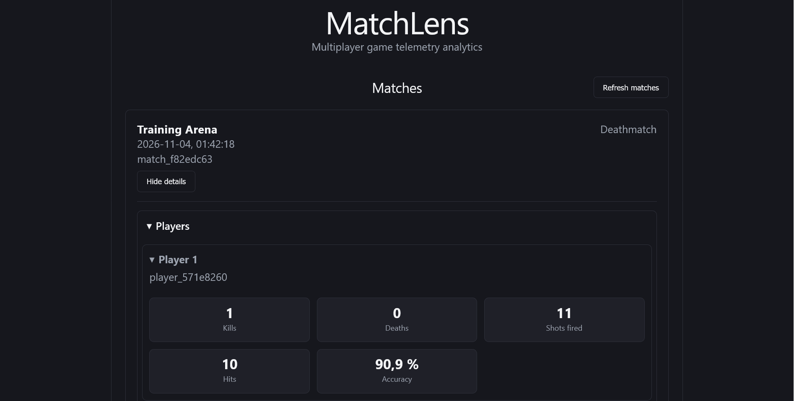
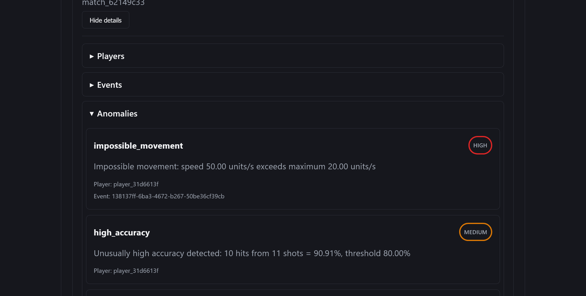

# MatchLens
[](https://github.com/Calle-Ahlgren/MatchLens/actions/workflows/ci.yml)

**MatchLens** is a full-stack game telemetry analytics platform built as a software development portfolio project. It generates simulated multiplayer events, ingests and stores them through a FastAPI API backed by PostgreSQL, and displays player statistics and suspicious behavior in a React dashboard.

## Dashboard preview

### Player statistics


### Anomaly detection


## Features

- **Telemetry ingestion:** REST endpoints for matches, players, and events, with Pydantic payload validation.
- **Player analytics:** On-demand kills, deaths, shots, hits, and accuracy.
- **Anomaly detection:** Explainable rules for impossible movement, high accuracy, and suspicious rifle fire rate.
- **Dashboard:** Match browsing, event filtering, player statistics, anomaly flags, and manual refresh.
- **Containerized setup:** PostgreSQL, FastAPI, and React/Nginx run together with Docker Compose.

## Quick start

**Prerequisites:** Git and Docker with Docker Compose. Python 3.12+ is needed **only to run the simulator locally**; it is not needed to start the containers. Node.js is not required.

From a terminal in your chosen projects directory:

```powershell
git clone https://github.com/Calle-Ahlgren/MatchLens.git
cd MatchLens
docker compose up --build -d
```

Open the [dashboard](http://127.0.0.1:3000) or [interactive API docs](http://127.0.0.1:8000/docs). A fresh database contains no matches until sample data is uploaded.

To generate and upload a match demonstrating the three anomaly scenarios, run from the repository root:

```powershell
python simulator\upload_sample_match.py --scenarios normal impossible_movement high_accuracy suspicious_fire_rate
```

In the dashboard, select **Refresh matches**, open the new match, and expand **Players**, **Events**, or **Anomalies**. To generate only ordinary match activity, use `--scenarios normal`.

Stop the stack without deleting data:

```powershell
docker compose down
```

**Note:** `docker compose down -v` also deletes the PostgreSQL data volume.

## Local development

For development, PostgreSQL can run in Docker while the backend and frontend run directly on the host. This requires Python 3.12+, Node.js, and Docker Compose.

Start PostgreSQL from the repository root:

```powershell
docker compose up -d postgres
```

In a separate PowerShell terminal, set up and start the backend:

```powershell
cd backend
python -m venv .venv
.\.venv\Scripts\Activate.ps1
python -m pip install -r requirements-dev.txt
python -m uvicorn app.main:app --reload
```

In another terminal, start the frontend:

```powershell
cd frontend
npm ci
npm run dev
```

The development dashboard is available at `http://127.0.0.1:5173`, with the API at `http://127.0.0.1:8000`.

To run backend tests and code checks from the `backend` directory with the virtual environment activated:

```powershell
python -m pytest
python -m ruff check .
python -m ruff format --check .
```

The development requirements include the runtime dependencies plus pytest, httpx, and Ruff. Docker installs only the runtime dependencies from `requirements.txt`.

## Tech stack

| Component | Technologies |
| --- | --- |
| Backend and data | Python, FastAPI, Pydantic, psycopg, PostgreSQL 16 (SQL/JSONB) |
| Frontend | React, TypeScript, Vite, Nginx |
| Analytics | Python, rule-based anomaly detection |
| Tooling | Docker Compose, pytest, FastAPI TestClient, Ruff, ESLint |

## Technical documentation

- [Architecture](docs/architecture.md) — System design, data model, and trade-offs.
- [Event contract](docs/event_contract.md) — Event types, required payloads, and player ownership semantics.

The backend has unit and database/API integration tests; frontend checks include linting and a production build. **Running those checks is optional for trying the Docker demo.**

MatchLens uses simulated data and illustrative detection thresholds. It is **not** a production anti-cheat system or a trained machine-learning model.
