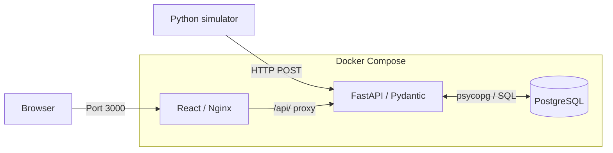
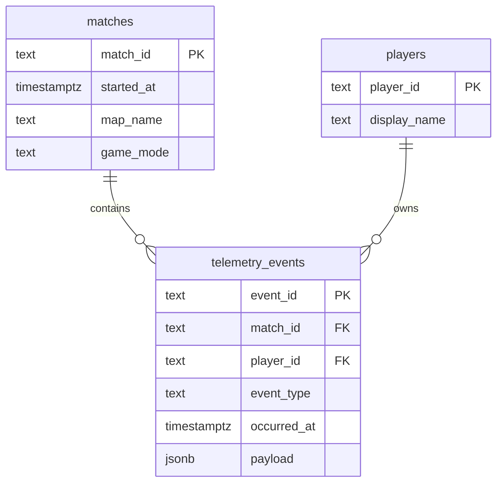

# Architecture

MatchLens separates telemetry generation, ingestion, persistence, analytics, and presentation into a small three-service application.

## System overview

- **Simulator:** Generates matches, players, and events; uploads them to the REST API from the host machine.
- **Backend:** FastAPI handles HTTP requests, Pydantic validates inputs, repository functions execute SQL, and services compute statistics and anomaly flags.
- **Frontend:** React displays match data. Nginx serves the built frontend and proxies `/api/` requests to FastAPI.

## Data model

The schema also includes timestamps such as `matches.ended_at`, `players.created_at`, and `telemetry_events.inserted_at`. PostgreSQL enforces primary and foreign keys; event-specific attributes are stored in JSONB and validated at the API layer. The API's `timestamp` maps to `occurred_at` in SQL. Match participation is inferred from events rather than a separate membership table.

## Processing

1. The simulator creates a match, then uploads its players and telemetry events via HTTP.
2. FastAPI validates the requests; psycopg writes raw records to PostgreSQL.
3. When the dashboard requests player statistics or anomalies, the backend reads the relevant events and computes the results **on demand**. Derived results are not stored in separate tables.

Player statistics include kills, deaths, shots, hits, and accuracy. The detectors flag movement speed, high accuracy, and rifle fire-rate anomalies using configurable rules, not a trained model.

## Design decisions and trade-offs

| Choice | Why it fits this MVP | Trade-off |
| --- | --- | --- |
| Direct SQL with psycopg | Explicit queries and little abstraction for three tables | Manual row mapping and query maintenance |
| Relational columns + JSONB payload | Core relationships remain structured while event types share one table | Payload constraints are primarily enforced by Pydantic, not PostgreSQL |
| On-demand analytics | Raw events remain the source of truth; rules can change without rebuilding stored results | Repeated computation may become costly at scale |
| Docker Compose | Reproducible local deployment without installing each service on the host | Not a production orchestration or public hosting solution |

The Docker setup uses a persistent PostgreSQL volume and a health check to sequence backend startup. The project intentionally omits authentication, streaming infrastructure, and cloud deployment; it is designed as a local portfolio demo.
